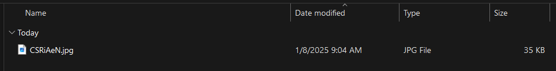
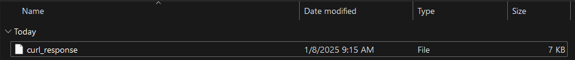
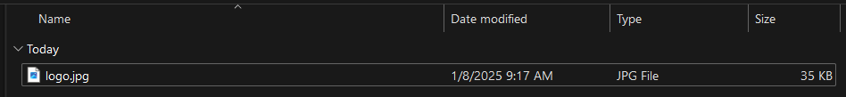

# 使用 cURL 下载文件指南

[](https://www.bright.cn/) 

本指南将介绍：

- [cURL 下载文件的基本语法](#curl-下载文件的基本语法)
- [使用 cURL 下载文件时如何处理更复杂的场景](#使用-curl-下载文件高级选项)
- [如何一次下载多个文件](#如何使用-curl-下载多个文件)
- [高效使用 cURL 的一些最佳实践](#使用-curl-下载文件的最佳实践)
- [cURL 与 Wget 的快速比较](#使用-curl-与-wget-下载文件的比较)

让我们开始吧！

---

## cURL 下载文件的基本语法

以下是最基本的 cURL 下载文件语法：

```powershell
curl -O <file_url>
```

> 💡 <strong>重要提示：</strong>在 Windows 上，`curl` 是 Windows PowerShell 中 [`Invoke-WebRequest`](https://github.com/bright-cn/Invoke-web-request-proxy) 的别名。为避免冲突，请将 `curl` 替换为 `curl.exe`。

[`-O`](https://curl.se/docs/manpage.html#-O) 和 `--remote-name` 标志会让 cURL 使用原始文件名保存下载的文件：

```powershell
curl --remote-name <file_url>
```  
例如，请看以下使用 cURL 下载文件的命令：

```powershell
curl -O "https://i.imgur.com/CSRiAeN.jpg"
```

这将生成如下所示的下载进度条：

```
% Total    % Received % Xferd  Average Speed   Time    Time     Time  Current
                                 Dload  Upload   Total   Spent    Left  Speed
100 35354  100 35354    0     0   155k      0 --:--:-- --:--:-- --:--:--  158k
```

当进度条达到 100% 时，运行 cURL 命令的文件夹中将出现一个名为 `CSRiAeN.jpg` 的文件：



要详细了解 cURL 及其选项，请[阅读我们的 cURL 指南](https://www.bright.cn/blog/web-data/what-is-curl)。

## 使用 cURL 下载文件：高级选项

接下来了解一些其他选项。

### 更改下载文件的名称

默认情况下，`-O` 选项会使用原始文件名保存下载的文件。如果 URL 中的远程文件不包含名称，cURL 会创建一个名为 `curl_response` 且没有扩展名的文件：



cURL 还会输出警告，说明这一行为：

```
Warning: No remote file name, uses "curl_response"
```

要为下载的文件指定自定义名称，请使用 [`-o`](https://curl.se/docs/manpage.html#-o)（或 `--output`）标志：

```powershell
curl "https://i.imgur.com/CSRiAeN.jpg" -o "logo.jpg"
```

cURL 将向指定的文件 URL 发出 GET 请求，并使用 `-o` 后指定的名称保存下载内容。这一次，输出文件将是 `logo.jpg` 文件：



### 跟随重定向

某些 URL 不会直接指向所需文件，需要自动跟随重定向才能到达最终目标地址。

要让 cURL 跟随重定向，请使用 [`-L`](https://curl.se/docs/manpage.html#-L) 选项：

```powershell
curl -O -L "<file_url>"
```

否则，cURL 将输出重定向响应标头，并且不会跟随 `Location` 标头中提供的新位置。

### 向服务器进行身份验证

某些服务器会限制访问并要求用户进行身份验证。要执行基本 HTTP 或 FTP 身份验证，请使用 [`-u`](https://curl.se/docs/manpage.html#-u) （或 `--user`）选项，并按以下格式指定用户名和密码：

```powershell
<username>:<password>
```

此格式不允许用户名中包含冒号，但密码可以包含冒号。

`<password>` 字符串是可选的。如果只指定用户名，cURL 会提示你输入密码。

以下是通过服务器身份验证使用 cURL 下载文件的语法：

```powershell
curl -O -u <username>:<password> <file_url>
```

例如，你可以使用以下命令通过身份验证从 URL 下载文件：

```powershell
curl -O -u "myUser:myPassword" "https://example.com/secret.txt"
```

### 设置带宽限制

要避免占用全部可用带宽，请使用 [`--limit-rate`](https://curl.se/docs/manpage.html#--limit-rate) 选项，后接你要设置的最高下载速度：

```powershell
curl -O --limit-rate 5k "https://i.imgur.com/CSRiAeN.jpg"
```
输出将类似于：

```
  % Total    % Received % Xferd  Average Speed   Time    Time     Time  Current
                                 Dload  Upload   Total   Spent    Left  Speed
100 35354  100 35354    0     0   5166      0  0:00:06  0:00:06 --:--:--  5198
```

`--limit-rate` 选项有助于控制带宽使用，以避免网络过载、遵守带宽限制，或模拟较慢的网络状况以进行测试。

### 通过代理服务器下载

为了保护隐私或规避[速率限制等反机器人措施](https://www.bright.cn/blog/web-data/anti-scraping-techniques)，请使用 [`-x`](https://curl.se/docs/manpage.html#-x) （或 `--proxy`）选项隐藏你的 IP，并通过代理路由请求：

```powershell
curl -x <proxy_url> -O <file_url>
```

`<proxy_url>` 必须按以下格式指定：

```powershell
[protocol://]host[:port]
```

代理 URL 会因使用 HTTP、HTTPS 还是 SOCKS 代理而有所不同。有关更详细的说明，请参阅我们的 [cURL 代理集成指南](https://www.bright.cn/blog/proxy-101/curl-with-proxies)。

例如，如果你使用 HTTP 代理，命令将变为：

```powershell
curl -x "http://proxy.example.com:8080" -O "https://i.imgur.com/CSRiAeN.jpg"
```

### 执行后台下载

要在输出中禁用进度条和错误消息，请使用 [`-s`](https://curl.se/docs/manpage.html#-s) （或 `--silent`）选项启用“静默”模式：

```powershell
curl -O -s "https://i.imgur.com/CSRiAeN.jpg"
```

如果下载成功，文件会出现在当前目录中，终端不会显示任何反馈。

### 输出详细信息

如果出现错误，或你想更深入地了解 cURL 在后台执行的操作，请添加 [`-v`](https://curl.se/docs/manpage.html#-v) （或 `--verbose`）选项来使用详细模式：

```powershell
curl -O -v "https://i.imgur.com/CSRiAeN.jpg"
```

这将启用包含详细信息的额外输出：

```
* IPv6: (none)
* IPv4: 146.75.52.193
*   Trying 146.75.52.193:443...
* schannel: disabled automatic use of client certificate
* ALPN: curl offers http/1.1
* ALPN: server accepted http/1.1
* Connected to i.imgur.com (146.75.52.193) port 443
* using HTTP/1.x
> GET /CSRiAeN.jpg HTTP/1.1
> Host: i.imgur.com
> User-Agent: curl/8.10.1
> Accept: */*
>
* Request completely sent off
* schannel: failed to decrypt data, need more data
< HTTP/1.1 200 OK
< Connection: keep-alive
< Content-Length: 35354
< Content-Type: image/jpeg
< Last-Modified: Wed, 08 Jan 2025 08:02:49 GMT
< ETag: "117b93e0521ba1313429bad28b3befc8"
< x-amz-server-side-encryption: AES256
< X-Amz-Cf-Pop: IAD89-P1
< X-Amz-Cf-Id: wTQ20stgw0Ffl1BRmhRhFqpCXY_2hnBLbPXn9D8LgPwdjL96xarRVQ==
< cache-control: public, max-age=31536000
< Accept-Ranges: bytes
< Age: 2903
< Date: Wed, 08 Jan 2025 08:51:12 GMT
< X-Served-By: cache-iad-kiad7000028-IAD, cache-lin1730072-LIN
< X-Cache: Miss from cloudfront, HIT, HIT
< X-Cache-Hits: 1, 0
< X-Timer: S1736326272.410959,VS0,VE1
< Strict-Transport-Security: max-age=300
< Access-Control-Allow-Methods: GET, OPTIONS
< Access-Control-Allow-Origin: *
< Server: cat factory 1.0
< X-Content-Type-Options: nosniff
<
{ [1371 bytes data]
100 35354  100 35354    0     0   212k      0 --:--:-- --:--:-- --:--:--  214k
* Connection #0 to host i.imgur.com left intact.
```

### 设置简化的进度条

你可以使用 `-#` （或 `--progress-bar`）选项启用更简洁的进度条：

```powershell
curl -O -# "https://i.imgur.com/CSRiAeN.jpg"
```

这将使用 `#` 字符显示进度条，并随着文件下载逐步填满：

```
########################################################### 100.0%
```

## 如何使用 cURL 下载多个文件

### 按范围下载文件

你可以使用花括号 `{}` 指定多个具有相同远程 URL 的文件并进行下载：

```powershell
curl -O "https://example.com/images/{1.jpg,2.jpg,3.jpg}"
```

这将下载指定的三个文件：

```
1.jpg
2.jpg
3.jpg
```

在这个特定示例中，你也可以使用常见的正则表达式 `[]` 语法：

```powershell
curl -O "https://example.com/files/file[1-3].jpg"
```

> **注意：**\
> 所有自定义选项（例如用于静默模式的 `-s` 或用于带宽限制的 `--limit-rate`）都将应用于正在下载的所有文件。

### 下载多个文件

要从不同的 URL 下载文件，你需要多次指定 `-O` 选项：

```powershell
curl -O "https://i.imgur.com/CSRiAeN.jpg" -O "https://brightdata.com/wp-content/uploads/2020/12/upload_blog_20201220_153903.svg"
```

输出中将为每个给定的 URL 显示一个下载进度条：

```
  % Total    % Received % Xferd  Average Speed   Time    Time     Time  Current
                                 Dload  Upload   Total   Spent    Left  Speed
100 35354  100 35354    0     0   271k      0 --:--:-- --:--:-- --:--:--  276k
  % Total    % Received % Xferd  Average Speed   Time    Time     Time  Current
                                 Dload  Upload   Total   Spent    Left  Speed
100 22467    0 22467    0     0  34657      0 --:--:-- --:--:-- --:--:-- 34724
```

同样，你可以使用多个 `-o` 选项为文件定义自定义名称：

```powershell
curl "https://i.imgur.com/CSRiAeN.jpg" -o "logo.jpg" "https://brightdata.com/wp-content/uploads/2020/12/upload_blog_20201220_153903.svg" -o "blog_post.svg"
```

你也可以混合使用 `-O` 和 `-o` 选项：

```powershell
curl "https://i.imgur.com/CSRiAeN.jpg" -o "logo.jpg" -O "https://brightdata.com/wp-content/uploads/2020/12/upload_blog_20201220_153903.svg"
```

> **注意：**\
> `-v`、`-s` 或 `--limit-rate` 等其他选项会应用于所有 URL，因此只需指定一次。

## 使用 cURL 下载文件的最佳实践

以下是一些最重要的 cURL 文件下载最佳实践：

- **在 Windows 上使用 `curl.exe` 而不是 curl**，以避免与 `Invoke-WebRequest` cmdlet 发生冲突。
- **忽略 HTTPS 和 SSL/TLS 错误**：使用 `-k`（或 `--insecure`）选项。
- **指定正确的 HTTP 方法**：使用 `-X` 选项指定 GET、POST 或 PUT。
- **用引号括住 URL，并使用 `\` 转义特殊字符**，以避免空格、与号等引发的问题。
- **指定代理以保护你的身份**：使用 `-x`（或 `--proxy`）选项。
- **在不同请求之间保存并重复使用 Cookie**：分别使用 `-c` 和 `-b` 选项。
- **限制下载速度以便更好地控制**：使用 `--limit-rate` 选项。
- **添加详细输出以进行调试**：使用 `-v` 选项。
- **检查错误响应**：始终使用 `-w` 选项检查 HTTP 响应代码。

## 使用 cURL 与 Wget 下载文件的比较

- **cURL** 可对数据传输进行更精细的控制，并支持自定义标头、身份验证以及更多协议。
- **Wget** 更简单，更适合批量下载、递归下载和处理中断的传输。

## 总结

每次发出 HTTP 请求时，你都会在互联网上留下痕迹。为了保护你的身份和隐私并增强安全性，可以考虑将代理与 cURL 集成：

- [数据中心代理](https://www.bright.cn/proxy-types/datacenter-proxies)：超过 770,000 个数据中心 IP。
- [住宅代理](https://www.bright.cn/proxy-types/residential-proxies)：覆盖 195 多个国家/地区的超过 7200 万个住宅 IP。
- [ISP 代理](https://www.bright.cn/proxy-types/isp-proxies)：超过 700,000 个 ISP IP。

[立即注册](https://www.bright.cn/)，免费测试我们的代理和抓取解决方案！
